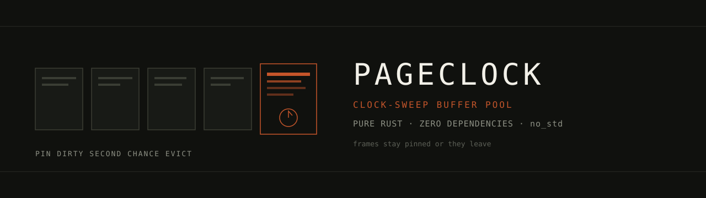

<p align="center">
  
</p>

# pageclock

Clock-sweep buffer pool for fixed-size pages. Pure Rust. Zero dependencies. `no_std`.

A storage engine already has a log and a table. The missing piece under both is the page cache: which images stay in memory, which are dirty, and which one the clock is allowed to take. Postgres shared buffers and the InnoDB buffer pool are this algorithm with a lot of machinery around it. `pageclock` is the algorithm, small enough to read in one sitting.

Rust 1.100 made custom allocators stable for `Vec` and `Box`. That is the heap. This crate does not compete with a bump pointer or a slab. A page cache sits under them: the unit of I/O is a page, and the unit of correctness is a pin.

## What it does

* Fixed frame table. `PAGE` and `FRAMES` are const generics. No allocation after [`Pool::new`](src/lib.rs).
* Pin / unpin. A pinned frame is invisible to the clock.
* Second chance. A hit sets a reference bit. The clock clears it once and only then reuses the frame.
* Dirty tracking. [`Pool::bytes_mut`](src/lib.rs) marks the frame dirty. Eviction calls your `flush` with the exact image before the frame is reused.
* Failed flush leaves the resident page in place. Failed load does not evict.
* CRC-32 trailer (ISO-HDLC) via [`Pool::seal`](src/lib.rs) / [`Pool::verify`](src/lib.rs). The known answer `crc32(b"123456789") == 0xCBF43926` is tested.
* The directory is a scan of frame headers. There is no side hash table to desynchronise. A miss is dominated by your `load`, not by a few thousand header checks.

## What it does not do

* It is single-threaded. Put a lock around it if more than one thread pins.
* `load` and `flush` must not re-enter the same pool. The pool is borrowed for the call.
* It does not read disks, speak Raft, or write a WAL. You pass those in as callbacks. See `nexus-wal` and `quorumdb` if you want those layers.
* It will not save you from forgetting a pin. An unpinned page is a candidate, not a leak.

## Usage

```rust
use pageclock::Pool;

fn main() -> Result<(), pageclock::Error> {
    let mut pool: Pool<4096, 64> = Pool::new();

    let frame = pool.pin(
        7,
        |dst| {
            dst.fill(0);
            Ok(())
        },
        |page_id, image| {
            let _ = (page_id, image);
            Ok(())
        },
    )?;

    pool.bytes_mut(frame)?[0] = 0xAB;
    pool.seal(frame)?;
    pool.verify(frame)?;
    pool.unpin(frame)?;
    Ok(())
}
```

`PAGE` must be at least 8 so a page can carry a payload and a 4-byte trailer. `FRAMES` must be at least 1. [`Pool::new`](src/lib.rs) panics otherwise.

## Clock

```text
pin hit  -> pins += 1, referenced = true
pin miss -> free frame, else walk from the hand:
              pinned            skip
              referenced        clear the bit, skip once
              otherwise         this is the victim
dirty victim -> flush(id, bytes) must return Ok before the frame is reused
```

## Tests

```bash
cargo test
```

The suite covers hits, pin counts, the full-pool refusal, second chance, exact dirty bytes, a flush that fails, a load that fails, clean eviction, checksum tampering, and a 200-step churn that checks every resident image.

## License

[MIT](LICENSE)
